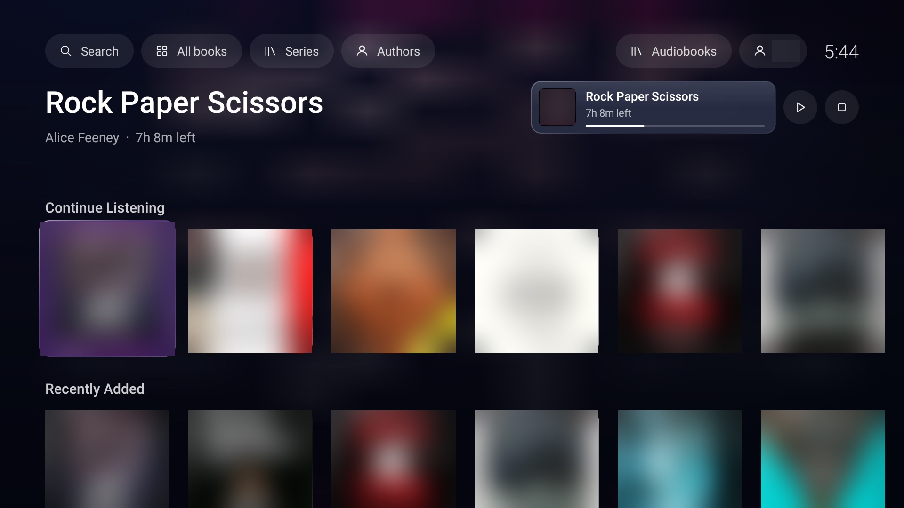
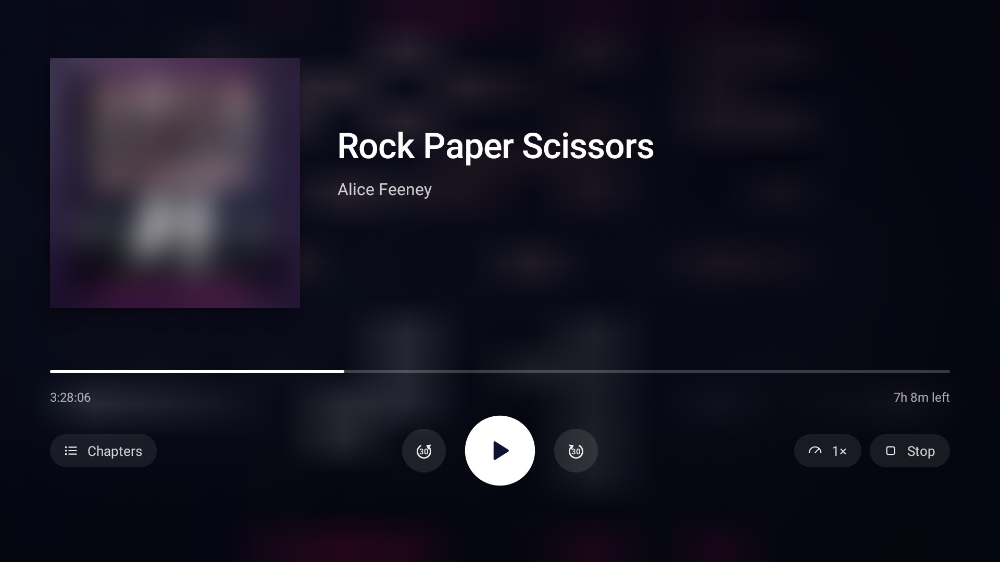

<p align="center">
  
</p>

<h1 align="center">Books</h1>

<p align="center">
  A lightweight <a href="https://www.audiobookshelf.org/">Audiobookshelf</a> player for Android TV, with a calm tvOS-style look.
</p>

<p align="center">
  
  
  
  
  
</p>

<p align="center">
  
  
</p>

## Features

- **Library:** the focused book large at the top, over a soft wash of its cover's colours. Below are rows from Audiobookshelf's home shelves: Continue Listening, Recently Added and the rest. Covers sit in frosted-glass tiles that lift, catch a light sweep and glow in the cover's colour when focused.
- **Browse everything:** Search, All books, Series and Authors, from the top of the library.
  - **All books:** a grid of the whole library, sorted by title, author, recently added or length. It loads more as you scroll.
  - **Series:** opening one lists its books in order and starts on the first one you haven't finished.
  - **Authors:** opening one shows that author's books.
  - **Search:** titles, authors, series and narrators, updated when you pause typing. Matching series and authors appear above the books.
- **Player:** the cover, title, author and narrator, and the chapter you're in. Below them are a full-width progress bar and the controls: skip back 30 s, play/pause and skip forward 30 s in the middle, Chapters on the left, and Speed (0.8–2×) and Stop on the right. The remote's media keys work too.
- **Scrubbing:** select the progress bar, then hold left or right to move through the book. The steps grow the longer you hold: 10 s, then 30 s, 2 min and 5 min. The time and chapter are shown as you go. Press OK, or pause for a moment, to jump; Back cancels. Chapter starts are marked on the bar.
- **Now playing:** while a book is loaded, a card at the top right of the library shows it with its progress. Select the card to open the player; the buttons beside it play/pause and stop.
- **Keeps your place:** progress is sent to Audiobookshelf every 15 seconds and on pause, so your phone and the web pick up where the TV left off.
  - Going back from the player to the library keeps the book playing.
  - Leaving Books, by the Home button or Back from the library, stops it.
  - It also stops after 15 minutes paused.
- **Sign in on the TV:** Books finds Audiobookshelf servers on your network, so you only type your username and password. An API key works too.
- **Built for slow TVs:** about 75 KB, plain Java, no libraries, and Android's own media player with direct play.
  - The background is a single pre-rendered image.
  - Focus animations run without redrawing anything.
  - Covers are fetched at the size they're shown, the ones on screen first.
  - A held D-pad or fast typing only updates the screen once things settle.

## Requirements

- **TV:** an Android TV or Google TV device on Android 5.0 or newer. It's tested on Android TV 9.
- **Server:** Audiobookshelf 2.26 or newer, which has the login tokens and API keys Books uses. It's tested with 2.36. The TV must be able to reach the server.

## Install

1. **Get the APK:** download `books-<version>.apk` from [Releases](../../releases).
2. **Install it on the TV**, either with adb from a computer or from a USB stick.

### With adb (recommended)

1. **Turn on developer options:** on the TV, open **Settings → Device Preferences → About** and select **Build** seven times. The menus vary by brand; on some TVs **About** is directly under Settings.
2. **Turn on debugging:** in **Settings → Device Preferences → Developer options**, turn on **USB debugging**, and **Network debugging** if your TV has it.
3. **Find the TV's IP address:** it's under **Settings → Network & Internet**, on your network's page.
4. **Install:** on the computer, with [Android platform tools](https://developer.android.com/tools/releases/platform-tools) installed, run:
   ```sh
   adb connect <tv-ip>:5555        # accept the prompt on the TV the first time
   adb install -r books-1.1.0.apk
   ```

### From a USB stick

1. Copy the APK to a USB stick and plug it into the TV.
2. Open the APK in a file manager app, such as *File Commander* or *X-plore*.
3. Allow that app to install apps when Android asks. On older TVs this is **Unknown sources**, under **Settings → Security & restrictions**.

**After installing:** Books appears with your other apps. To update, install a newer APK the same way; your login and settings are kept.

## Connect to Audiobookshelf

### Sign in on the TV

1. **Open Books.** The first time, it opens the sign-in screen and searches your network for Audiobookshelf. This takes a few seconds. Servers it finds are listed on the left, and the first one is filled in for you.
2. **Pick your server**, or type its address in **Server**. Press OK on a field to open the TV's keyboard. Accepted forms:
   - `192.168.1.20:13378`, which Books treats as `http://`;
   - `https://abs.example.com`, for a server behind a reverse proxy.
3. **Enter your username and password**, then select **Sign in**.

Books keeps your login and renews it in the background: the access token lasts an hour and the refresh token 30 days. You stay signed in as long as you open Books at least once a month. To sign out or switch servers, select the account pill (your username) at the top right of the library.

### Or connect with an API key

Use this if your server only allows single sign-on (OpenID), or you'd rather not type a password with a remote.

1. **Create a key:** in Audiobookshelf on the web, open **Settings → API Keys → Add API Key**. Pick your user and choose no expiry. Only admins can create keys.
2. **Send it to the TV:** from this repository, on a computer with adb connected to the TV, run:
   ```sh
   TV=<tv-ip>:5555 sh connect.sh http://<server-ip>:13378
   ```
   It asks for the key without showing it, checks it against the server, and sends it to Books.

### If it can't connect

- **No servers found:** the search only covers the TV's own network (its /24) on ports 13378 and 80. If your server is on another subnet, a different port, or behind a reverse proxy, type its address instead.
- **A `.local` name doesn't work:** Android TV 9 and older can't resolve `.local` names. Use the server's IP address.
- **"Wrong username or password":** check them in the Audiobookshelf web app first.
- **"Too many tries":** Audiobookshelf limits login attempts. Wait a minute and try again.
- **"Only allows single sign-on":** use an API key.

## Build from source

You need Java 17 and the Android SDK (`platforms;android-34`, `build-tools;34.0.0`). There's no Gradle: `build.sh` runs the SDK's tools directly.

```sh
sh build.sh                    # creates key.jks on the first build; keep it for updates
adb install -r out/books.apk
```

## Remove

```sh
adb uninstall com.amalkrishna.books
```

You can also uninstall it from **Settings → Apps** on the TV.
